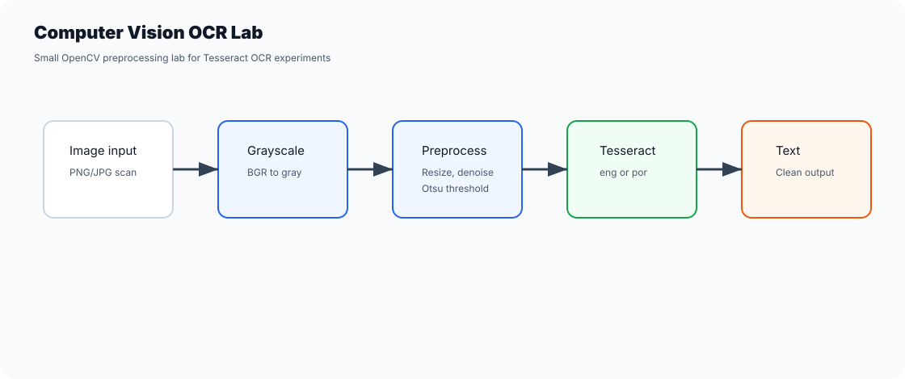
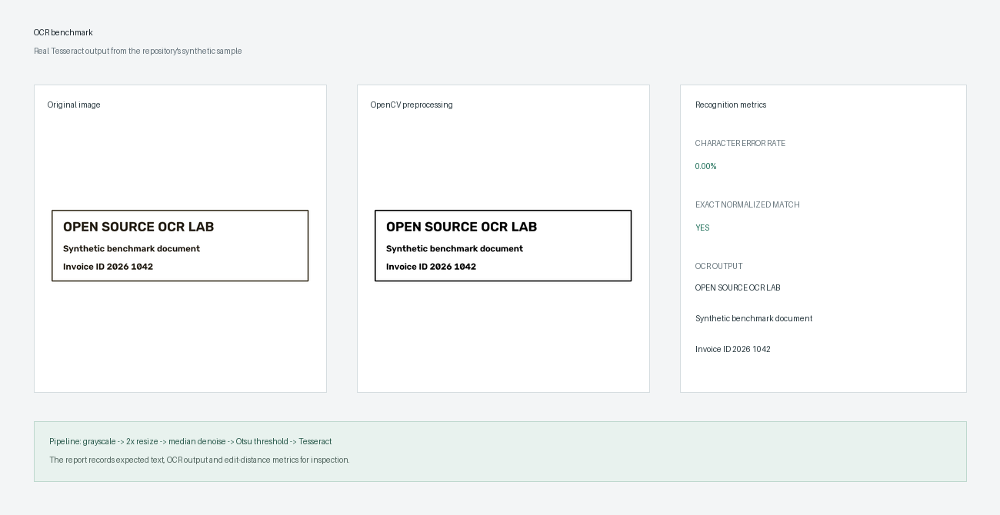

# Computer Vision OCR Lab

[English / README principal](README.md) · Português (Brasil)

Pequeno laboratório de OCR com OpenCV + Tesseract, com uma CLI organizada, funções auxiliares de pré-processamento, testes e arquivos de exemplo seguros.





Este repositório é uma reconstrução pronta para portfólio de um projeto antigo de aprendizado de OCR. Ele mantém as ideias úteis de visão computacional e remove caminhos específicos de máquinas e arquivos privados de exemplo.

## O que demonstra

- Carregamento de imagens com OpenCV.
- Conversão de BGR para escala de cinza.
- Pré-processamento com redimensionamento, remoção de ruído por filtro de mediana e limiarização de Otsu.
- Interface opcional para o Tesseract OCR.
- Ponto de entrada pela CLI.
- Testes automatizados do comportamento do pré-processamento.
- CI com GitHub Actions.
- Métricas de taxa de erro de caracteres e correspondência exata normalizada para uma avaliação de OCR verificável.

## Instalação

Instale o Tesseract OCR localmente se quiser executar OCR real. Para OCR em português, instale os dados do idioma `por`.

Depois:

```bash
python -m venv .venv
.venv\Scripts\activate
python -m pip install -r requirements.txt
```

Se o Tesseract não estiver no seu PATH, defina:

```bash
set TESSERACT_CMD=C:\Program Files\Tesseract-OCR\tesseract.exe
```

## Execução

```bash
python -m ocr_lab.cli sample_images/sample-text.pbm --lang eng
```

Para OCR em português:

```bash
python -m ocr_lab.cli path/to/image.png --lang por
```

## Testes

A suíte de testes não exige o executável do Tesseract. Ela valida as funções auxiliares de pré-processamento do OpenCV.

```bash
pytest
```

Com o Tesseract instalado, gere novamente o artefato público do benchmark:

```bash
python scripts/run_demo_benchmark.py
```

O script grava `docs/benchmark.json` e uma captura de tela comparativa gerada a partir da
imagem sintética de exemplo. Nenhum documento pessoal ou comercial digitalizado é usado.

## Notas de portfólio

Este projeto é intencionalmente pequeno e fácil de inspecionar. Ele demonstra pré-processamento de imagens, limites entre dependências e como transformar um experimento rápido com Tkinter/Tesseract em um repositório público mais organizado.
